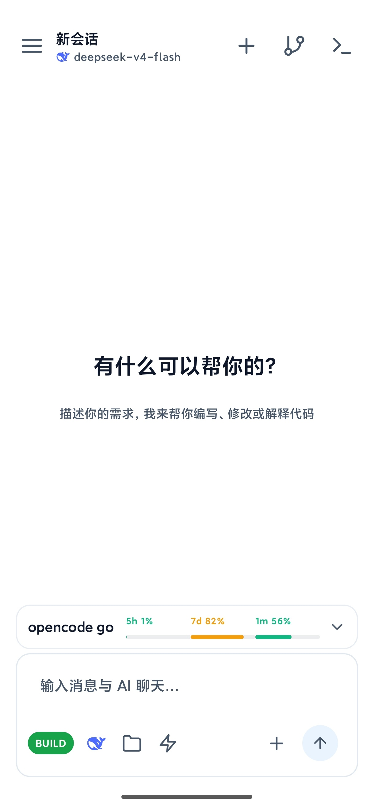
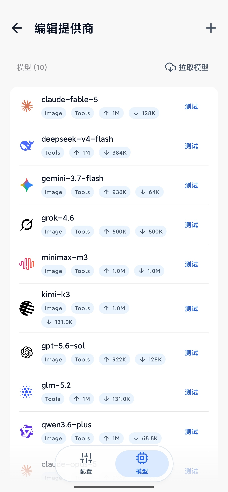

<div align="center">


# AiCode

**An AI coding workstation on your phone — not just chat, it writes code, runs builds, ships results**

Built-in Linux container & terminal · AI Agent reads/writes files, runs commands, debugs code · Local & remote SSH backends

[中文](README.md) · [English](README.en.md)

<br/>

[](LICENSE)
[](https://github.com/hwsyyds666/Aicode-Glass/releases/latest)
[](https://github.com/hwsyyds666/Aicode-Glass/releases)
[](https://github.com/hwsyyds666/Aicode-Glass/stargazers)

[Download](https://github.com/hwsyyds666/Aicode-Glass/releases/latest) · [Features](#-core-highlights) · [Screenshots](#-screenshots) · [Quick Start](#-quick-start) · [Docs](https://aicode.murk.top)

</div>

---

> **Fork Notice** · Based on [jieapi/AiCode](https://github.com/jieapi/aicode), adding Liquid Glass UI, ChatGPT multi-account aggregation with quota routing, Super Agent with parallel subagents, notification-bar task progress, maximized context caching, and more. Released under the same [GPL-3.0](LICENSE) license.

## 💡 What is this

**In one sentence**: Run a real AI coding Agent on your phone — not just one that replies with code snippets, but one that **reads/writes files, executes shell commands, runs builds, and debugs errors** — all on-device.

- Built-in Alpine Linux container + terminal, the AI directly manipulates the file system
- Remote SSH backend supported — your phone becomes a mobile workstation for remote projects
- No bundled models, no vendor lock-in — OpenAI / Anthropic / Gemini protocols all supported

## 🌟 Core Highlights

### 📱 Phone = Workstation

Not a chat wrapper. The AI Agent has a full toolchain: file read/write/edit, shell execution, background terminal, code search, web fetch, image recognition, image generation, todo management. **Tell it "write me a web service and run it" — it writes the code, installs dependencies, starts the server, and fixes errors on its own.**

### 🔐 ChatGPT Multi-Account Aggregation + Quota Routing

Batch import official OAuth accounts, model selector aggregates all accounts into a single group sorted by subscription tier. Smart quota routing: **free models go to free accounts, paid-only models go to paid accounts**. Session affinity binds a session to one account by default; credentials that fail are soft-unbound. Quota-paused / offline / disabled accounts are never silently switched. Aligned with cockpit-tools import format.

### 🧠 Super Agent · Proactive Parallel Dispatch

When enabled, the AI **proactively** splits research/investigation tasks into parallel subagents — Explore, Research, Worker, and Reviewer roles working together. Workers have scoped writes, cannot nest agents, and the main session reviews and consolidates results. No more manually asking "use subagents."

### 📢 Notification Bar Task Progress

While the AI runs a task, a persistent notification shows what it's doing — thinking, generating, with a summary of each section visible on expand. Multiple parallel tasks show "N tasks running"; auto-dismisses on completion. **You don't need to stare at the screen to know where the AI is at.**

### ⚡ Maximized Context Caching

Anthropic uses all 4 `cache_control` breakpoints (system prompt + tool definitions + original question + rolling breakpoint). The ever-growing history in tool loops flows through the rolling breakpoint — **each step writes a fresh cache and the next step reads it**, so only the last entry is recomputed on long tasks. Dramatically reduces token cost and latency.

### ⏪ Checkpoints & One-Tap Rollback

Snapshots are recorded before the agent edits code. Not satisfied? **Roll back code, chat history, or both — in one tap.** No fear of the AI breaking things.

### 🌿 Visual Git + GitHub Workspace

Status, branches, commit history, diffs, and tags at a glance — staging, discarding, sign-off supported. Connect GitHub via Device Flow, browse and clone repos, create Pull Requests with confirmation.

### 🪟 Liquid Glass UI

Refraction, chromatic dispersion, and gradient glass effects powered by [PrismalAGSL](https://github.com/styropyr0/PrismalAGSL). Floating glass title bar, light/dark themes, Material You colors, custom background images.

## 📸 Screenshots

<table>
  <tr>
    <td align="center"></td>
    <td align="center"></td>
  </tr>
  <tr>
    <td align="center">Home · AI Chat</td>
    <td align="center">Git · Commit History</td>
  </tr>
  <tr>
    <td align="center"></td>
    <td align="center"></td>
  </tr>
  <tr>
    <td align="center">Container · Image Manager</td>
    <td align="center">Models · Provider List</td>
  </tr>
</table>

## 🔀 Three Run Modes

| Mode | Purpose | Behavior |
| :-- | :-- | :-- |
| **BUILD** | Normal development | Executes per your tool authorization rules |
| **PLAN** | Plan then execute | Shows a task list first, then executes step by step |
| **ASK** | Read-only Q&A | Explores and answers questions; writes are hard-denied |

## 📦 Quick Start

**System requirements**: Android 8.0+ (API 26), arm64-v8a / x86_64

**1. Download**

Get it from [GitHub Releases](https://github.com/hwsyyds666/Aicode-Glass/releases/latest):

| Package | Target |
| :-- | :-- |
| `armsolo` | Real devices (arm64-v8a) |
| `x86solo` | Emulators (x86_64) |
| `universal` | Universal build — when in doubt, pick this |

**2. Three steps**

1. Go to **Settings → AI Vendors**, configure your model, API key, and endpoint
2. In **Container & Images**, pick local container or remote SSH
3. **New Session** — start chatting

> 📖 For detailed guides, see [Online Docs](https://aicode.murk.top) (same content as in-app docs)

<details>
<summary><b>🔧 More Features</b></summary>
<br/>

**AI Agent**
- Built-in tools: file read/write/edit, shell execution, background terminal, code/web search, image recognition, image generation, todo management
- Streaming output + live Markdown rendering + automatic context compression
- Global/project-level Skills and long-term memory for cross-session reuse
- MCP protocol support — connect local (stdio) or remote (HTTP) MCP servers to extend tools
- Per-tool authorization rules + user-overridable system prompts that survive upgrades

**Models & Providers**
- Model-agnostic: no bundled models, no vendor lock-in
- Protocol support: OpenAI / Anthropic / Gemini + custom providers
- Multiple keys per provider with sequential or round-robin rotation
- Adjustable reasoning effort

**Development Environment**
- Built-in terminal & container: Termux + PRoot local Linux container with Alpine image, custom rootfs support, host directory mounting, multi-tab background terminals
- Remote SSH mode: remote server as execution backend — commands, files, terminal all act on remote
- File tree & code editor: indented tree + full-screen editor with syntax highlighting, Markdown preview, `file:line` jump from AI replies
- Workspace sync: SFTP / FTP sync + built-in FTP server

**Experience**
- Tablet & large screen: persistent sidebar on wide screens with code/terminal beside chat
- Token stats: usage and cost estimates per provider and model with call-level drill-down
- Appearance: light/dark themes, preset colors, Material You, custom backgrounds, bilingual (CN/EN)
- Network proxy: global and per-provider proxy configuration
- Backup & restore: encrypted export/import of provider configs, chat history, workspace files

</details>

## 🏗 Build from Source

```bash
git clone https://github.com/hwsyyds666/Aicode-Glass.git
cd AiCode
./gradlew assembleDebug
```

Build output is in `app/build/outputs/apk/`. Requires JDK and Android SDK.

<details>
<summary>Project structure</summary>

```text
AiCode
├── app/                # Android main app
├── terminal-emulator/  # Terminal emulator core (based on Termux)
├── terminal-view/      # Terminal view components (based on Termux)
├── prismalrepo/        # PrismalAGSL liquid glass library (local Maven repo)
├── docs/               # Icons, screenshots, docs assets
└── docs-site/          # Online documentation site source
```
</details>

## ⭐ Star History

If AiCode helps you, give it a ⭐ Star — it helps more developers discover the project.

[](https://www.star-history.com/#hwsyyds666/Aicode-Glass&Date)

## 💬 Feedback & Contribution

- 🐞 **Bug reports**: [Issues](https://github.com/hwsyyds666/Aicode-Glass/issues) (include repro steps, device model, OS version)
- 💡 **Feature requests**: discuss in [Issues](https://github.com/hwsyyds666/Aicode-Glass/issues)
- 🔧 **Contributing**: [Pull Requests](https://github.com/hwsyyds666/Aicode-Glass/pulls) welcome
- 💬 **QQ group**: [AiCode QQ group](https://qm.qq.com/q/ByvqODJdIs) (group number: 1107110698)

<a href="https://github.com/hwsyyds666/Aicode-Glass/graphs/contributors">
  
</a>

## 🙏 Acknowledgements

- **[jieapi/AiCode](https://github.com/jieapi/aicode)** — Original project, the foundation of this fork
- [OpenCode](https://github.com/anomalyco/opencode) — Core inspiration
- [Termux](https://github.com/termux/termux-app) — Terminal emulator and PRoot solution
- [Kelivo](https://github.com/Chevey339/kelivo) — AI chat UI design reference
- [PrismalAGSL](https://github.com/styropyr0/PrismalAGSL) — Liquid glass effect library

## 📄 License

[GPL-3.0](LICENSE) · Third-party notices: [NOTICE](NOTICE)

<div align="center">

<sub>Made with ❤️ on Android</sub>

</div>
