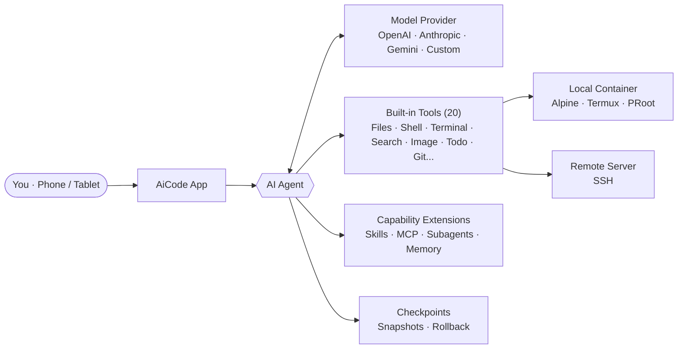

<div align="center">


# AiCode

**An AI coding workstation on your phone — not just chat, it writes code, runs builds, ships results**

Built-in Linux container & terminal · AI Agent reads/writes files, runs commands, debugs code · Local & remote SSH backends

[中文](README.md) · [English](README.en.md)

<br/>

[](LICENSE)
[](https://github.com/hwsyyds666/Aicode-Glass/releases/latest)
[](https://github.com/hwsyyds666/Aicode-Glass/releases)
[](https://github.com/hwsyyds666/Aicode-Glass/stargazers)

[Download](https://github.com/hwsyyds666/Aicode-Glass/releases/latest) · [Features](#core-highlights) · [Screenshots](#screenshots) · [Quick Start](#quick-start) · [Docs](https://aicode.murk.top)

</div>

---

> **Fork Notice** · Based on [jieapi/AiCode](https://github.com/jieapi/aicode), released under the same [GPL-3.0](LICENSE) license. This fork adds Liquid Glass UI, ChatGPT multi-account aggregation with quota routing, Super Agent with proactive parallel subagents, notification-bar task progress, maximized context caching, and global performance optimizations.

---

## What is this

Most AI chat apps stop at "ask the AI for a code snippet, copy it to your computer, run it." AiCode is different — **it packs a complete development environment into your phone**, so the AI doesn't just output code text, it **gets its hands dirty**:

- Uses `readFile` to read your project files and understand context
- Uses `editFile` / `writeFile` to directly modify code
- Uses `Bash` to run shell commands — install dependencies, run tests, start services
- Uses `search` to do ripgrep full-text search across your codebase
- Uses `websearch` / `webfetch` to look up docs and fetch web pages
- Uses `terminal` to open a background terminal for long-running tasks
- Uses `generateImage` to create images, `viewImage` to analyze images
- Reads error logs, fixes the issue, runs it again

**Tell it "write me a web service and run it" — it writes the code, installs dependencies, starts the server, fixes errors on its own. All on your phone. No computer needed.**

This is not a chat wrapper. It's an AI Agent with hands and feet. It has its own toolbox: read/write files, execute shell, manage Git, search codebases, browse the web. You give it a goal, and it breaks it down, calls tools, inspects results, corrects itself — until the task is done or it needs your input.

### Two Execution Backends

All file operations and shell commands act on your chosen **execution backend**:

- **Local container**: An Alpine Linux container built on Termux + PRoot, running on-device. No server needed — install the app and go. Supports custom rootfs images and host directory mounting; multi-tab terminals can stay alive in the background.
- **Remote SSH**: Use a remote server as the execution backend. Commands, files, and terminal all act on the remote project. Your phone becomes a mobile workstation for remote projects — fix code, run builds, check logs while traveling.

Switching backends is one tap. The AI is unaware of the switch — its tool calls automatically route to the active backend.

### Model-Agnostic, Keys Under Your Control

AiCode **ships no models and locks you into no vendor**. It supports three major protocols:

- **OpenAI protocol**: ChatGPT series, GPT-4o, o1, etc.; also compatible with any OpenAI-compatible endpoint (Together, Groq, DeepSeek, etc.)
- **Anthropic protocol**: Claude 3.5 / 4 Sonnet, Opus, etc.
- **Gemini protocol**: Gemini 1.5 / 2.0 Flash / Pro

Model names, API keys, and endpoint URLs are all configured by you. Multiple keys per provider with sequential or round-robin rotation. Adjustable reasoning effort. The app never collects or uploads your keys — everything is stored locally, optionally encrypted with Android Keystore.

## Core Highlights

### 1. Phone = Workstation — 20 Built-in Tools

The AI Agent has a complete toolchain covering file operations, command execution, search, web access, image handling, and code hosting:

| Tool | Capability |
| :-- | :-- |
| `readFile` / `writeFile` / `editFile` | Read, create, diff-edit files — `editFile` uses structured diffs, only changing the lines that need changing |
| `list` | List directory tree in indented format |
| `search` | ripgrep full-text search — regex, file filters, context lines |
| `Bash` | Execute shell commands — install deps, run tests, start services, pipe chains |
| `terminal` | Background terminal — run long tasks, output streams back to the AI |
| `websearch` | AI-driven parallel web search |
| `webfetch` | Fetch web pages, convert to Markdown for the AI |
| `viewImage` | Image recognition — screenshots, UI mockups, design references |
| `generateImage` | Text-to-image — supports GPT-Image, DALL-E, and other image models |
| `sendFile` | Send files to a specified path |
| `createPullRequest` | Create GitHub PRs — requires confirmation each time, never auto-pushes |
| `planMode` | Plan mode — draft a task list before executing |
| `memory` | Long-term memory — reuse experience and project conventions across sessions |
| `loadSkill` | Load skills — global or project-level reusable capability packages |
| `manageMcp` | Manage MCP servers — connect external tool capabilities |
| `askUserQuestion` | Ask the user — proactively seek input at decision points |
| `browser` | Browser tool — automate web page interactions |
| `Shizuku` | Shizuku integration — system operations requiring elevated permissions |

**Key point**: These tools aren't for you — they're for the AI. You describe the goal in natural language, and the AI decides which tool to call, what parameters to pass, and how to combine them. Streaming output renders Markdown in real time; tool calls and results are visualized in the chat so you always see what the AI is doing.

### 2. ChatGPT Multi-Account Aggregation + Smart Quota Routing

Connect to the official Codex Responses API via "Sign in with ChatGPT," with support for batch-importing multiple ChatGPT accounts. This feature aligns with cockpit-tools export formats — compatible with sub2api, refresh-token-only, inline JSON arrays, and other credential forms. Tokens are encrypted on-device with Android Keystore.

**Model selector aggregation**: All ChatGPT accounts merge into a **single group** in the model selector, sorted by subscription tier descending. You see "ChatGPT accounts" as one group, not one provider entry per account. When you select a model, the system automatically decides which account to use — you don't manually pick.

**Smart quota routing**:

- **Free models go to free accounts** — if you have free-tier accounts, free models route there by default, saving paid quota
- **Paid-only models go to paid accounts only** — models marked `paidOnly` (e.g., GPT-6 Sol, Astra) route exclusively to paid-tier accounts, never to free accounts where the upstream would reject them
- **Session affinity** — a session binds to one account by default, preventing context fragmentation across accounts. Credentials that fail are soft-unbound; the next request rebinds
- **Safe fallback** — accounts that are quota-paused, offline, or disabled are never silently switched. It's better to error and let you know than to secretly swap accounts

**Catalog aligned with the official client**: filtered only by `visibility` (hide = not shown), not by `available_in_plans`. Opening the selector triggers a 30-minute TTL silent refresh so the catalog never goes stale. Discontinued/deprecated models are automatically removed.

### 3. Super Agent — Proactive Parallel Subagent Dispatch

When "Super Agent" is enabled, the AI **proactively** splits parallelizable tasks into multiple subagents running simultaneously, instead of doing everything serially step by step. Four roles work together:

| Role | Capability | Scope |
| :-- | :-- | :-- |
| **Explore** | Read-only local exploration — search codebases, browse file structure | Read-only |
| **Research** | Web-only research — search the web, fetch docs, investigate options | Read-only + web |
| **Worker** | Code changes — implement features within a specified writable scope | Scope-validated writes |
| **Reviewer** | Read-only independent review — verify requirements vs. diff, isolated from the main agent's reasoning | Read-only |

**Safety constraints**:
- Multiple Workers' writable scopes cannot overlap — prevents concurrent write conflicts
- Subagents cannot nest — a subagent cannot spawn its own subagents
- After dispatch, the main agent must review each subagent's results and diff — max two rounds of rework
- In PLAN mode, a visible plan is written before dispatching; Super Agent doesn't bypass PLAN

**In practice**: Say "investigate three tech options: A, B, and C" — the AI dispatches three Research subagents in parallel, instead of searching three times serially. Say "update both frontend and backend" — the AI dispatches two Workers, each with its own directory's writable scope. **You don't need to manually say "use subagents" — enabling Super Agent means you expect the AI to parallelize proactively.**

### 4. Notification Bar Task Progress — Know Where the AI Is Without Watching

While the AI runs a task, a persistent notification shows progress. It's a foreground Service notification; expand it to see:

- **Live preview**: What the AI is currently thinking (ReasoningDelta) or generating (AssistantDelta) — the first 80 characters are shown directly in the notification body. Expand the notification to see what the AI is writing right now.
- **Section summaries**: After each section completes (AssistantText event), the first 120 characters are appended as a summary to the step list. Expanded notification shows them in chronological order — like an execution log.
- **Multi-task parallel**: When Super Agent dispatches multiple subagents, the notification shows "N tasks running," with each task's title and current step listed when expanded.
- **Auto-dismiss on completion**: The notification disappears when the task is done.

Notification refresh is strictly throttled — 200ms time window + StateFlow incremental dedup — so the high-frequency streaming deltas never overwhelm the notification system or lag the device.

### 5. Maximized Context Caching — Long Tasks Cost Less

Anthropic's prompt caching supports up to 4 `cache_control` breakpoints. AiCode uses them all:

1. **System prompt** (static, near-zero cost after cache hit)
2. **Tool definitions** (static, same)
3. **Original user question** (unchanged within a conversation turn)
4. **Rolling breakpoint** — placed on the most recent assistant message with body text

The ever-growing `assistant + tool_result` history in tool loops flows through the **rolling breakpoint**: each step writes a fresh cache, and the next step reads the previous one. The effect: **long tasks only recompute the last tool_result**; all prior history hits the cache.

This is especially critical for Agent workflows — the Agent may run a dozen rounds in a tool loop, each with file reads, command execution, and code changes in the history. Without rolling cache, each step would resend the complete history to the model, with token cost and latency growing linearly with rounds. With the rolling breakpoint, cost approximates only the current round — long tasks remain affordable.

### 6. Checkpoints & One-Tap Rollback — No Fear of AI Breaking Things

Before the AI edits code, the system automatically records a file snapshot. Not satisfied? **One-tap rollback**:

- Roll back code only (conversation preserved, files restored to pre-edit state)
- Roll back conversation only (code preserved, chat rewound to a checkpoint)
- Roll back both

Snapshots are file-level and don't depend on Git — works even if your project isn't under version control. This gives you peace of mind: let the AI be bold; if it breaks things, pull it back.

### 7. Three Run Modes — Switch by Trust Level

| Mode | Purpose | Behavior |
| :-- | :-- | :-- |
| **BUILD** | Normal development | Executes per your tool authorization rules — hands-off when you trust it |
| **PLAN** | Plan then execute | AI uses `planMode` to submit a visible task list first; you review before it executes; same tool permissions as BUILD |
| **ASK** | Read-only Q&A | AI can only explore and answer — **writes are physically blocked by the system**; ASK mode also disallows the AI from switching to PLAN on its own |

Switch AI permissions by trust level: use ASK to investigate an unfamiliar project, switch to PLAN for a plan, then BUILD to execute.

**Tool authorization**: Each tool can be configured with authorization rules — auto-approve, ask each time, or hard-deny. For example, set `writeFile` to ask each time (confirm every file change), `readFile` to auto-approve, `Bash` to ask each time. System prompts are also user-overridable and survive app upgrades.

### 8. Visual Git + GitHub Workspace

- **Git integration**: Visual management of status, branches, commit history, diffs, and tags. Supports staging, discarding, sign-off, and credential configuration — no need to type `git` commands.
- **GitHub connection**: Connect your GitHub account via OAuth Device Flow — no password typing on your phone, device-code authorization. After connecting, browse repositories with pagination, clone public/private repos to the local container or remote SSH. The AI can use the `createPullRequest` tool, but **every creation requires your confirmation** — the app never pushes a branch on your behalf.

### 9. Skills & Long-Term Memory

- **Skills**: Reusable capability packages, split into global (all projects) and project-level (current project only). Skills can hold prompt templates, tool combination workflows, project conventions. The AI loads them on demand with `loadSkill`.
- **Long-term memory**: The AI uses the `memory` tool to write cross-session valuable information — your preferences, project conventions, past decisions. Auto-loaded in the next conversation; you don't need to re-explain context every time.

### 10. MCP Protocol — Capabilities on Demand

Supports connecting **Model Context Protocol** servers — local (stdio) or remote (HTTP). MCP servers can expose additional tool capabilities to the AI — database queries, external API operations, enterprise internal systems. The AI manages MCP server connections with the `manageMcp` tool.

### 11. Liquid Glass UI

AGSL shader-based refraction, chromatic dispersion, and gradient glass effects powered by [PrismalAGSL](https://github.com/styropyr0/PrismalAGSL). Floating glass title bar, liquid glass cards, dynamic blur backgrounds. Supports light/dark themes, preset color schemes, Material You colors, custom background images. Bilingual (Chinese/English) UI; tablet and large-screen adaptive layout.

## Screenshots

<table>
  <tr>
    <td align="center"></td>
    <td align="center"></td>
  </tr>
  <tr>
    <td align="center">Home · AI Chat</td>
    <td align="center">Git · Commit History</td>
  </tr>
  <tr>
    <td align="center"></td>
    <td align="center"></td>
  </tr>
  <tr>
    <td align="center">Container · Image Manager</td>
    <td align="center">Models · Provider List</td>
  </tr>
</table>

## Use Cases

<details>
<summary><b>📖 Click to expand typical scenarios</b></summary>

**Scenario 1: Emergency bug fix on the road**

You're on a train. A colleague reports a production bug. You pull out your phone, open AiCode, connect to the company's remote SSH server. Tell the AI: "Check `auth/login.py` for the error — looks like a null pointer." The AI `readFile`s the code, `Bash` runs tests, locates the issue, `editFile` changes one line, runs tests again to confirm. You review the diff, confirm, and `Bash` does `git commit && git push`. No laptop opened.

**Scenario 2: Prototype from scratch**

You want to validate an idea — a simple Flask API. On your phone, open AiCode in local container mode. Tell the AI: "Write a TODO API with Flask, full CRUD, run it and show me." The AI `Bash`es to install Flask, `writeFile`s the code, `Bash` starts the server, reads errors, fixes them. Finally shows you `curl` test output proving the API works. The notification bar shows progress throughout — no need to watch.

**Scenario 3: Multi-account ChatGPT savings**

You have 2 free ChatGPT accounts and 1 paid account. Daily chat uses free models — the system auto-routes to free accounts. When a task needs GPT-6 Sol or another paid model, the system auto-routes to the paid account. You don't switch manually — quota routing handles it. Session affinity ensures a conversation isn't bounced between accounts, preventing context fragmentation.

**Scenario 4: Super Agent parallel research**

You need to make a tech decision. Tell the AI: "Investigate FastAPI vs Express vs Hono — compare performance, ecosystem, learning curve." Super Agent is on. The AI dispatches three Research subagents in parallel — one for FastAPI, one for Express, one for Hono. All three run simultaneously; in minutes you get a comparison table. Instead of serially searching three times and waiting three times as long.

**Scenario 5: Read-only investigation, no code touched**

You're looking at an unfamiliar open-source project. Switch to ASK mode. The AI can only `readFile`, `search`, `list` — read code, search code, list directories, but cannot write or execute anything. You let it explore freely; ask anything. It will never change a single character of your code.

</details>

## Quick Start

**System requirements**: Android 8.0+ (API 26), arm64-v8a / x86_64

**1. Download**

Get it from [GitHub Releases](https://github.com/hwsyyds666/Aicode-Glass/releases/latest):

| Package | Target |
| :-- | :-- |
| `armsolo` | Real devices (arm64-v8a) |
| `x86solo` | Emulators (x86_64) |
| `universal` | Universal build — when in doubt, pick this |

**2. Three steps**

1. Go to **Settings → AI Vendors**, configure your model, API key, and endpoint
2. In **Container & Images**, pick local container or remote SSH
3. **New Session** — start chatting

> 📖 For detailed guides, see [Online Docs](https://aicode.murk.top) (same content as in-app docs)

## Build from Source

```bash
git clone https://github.com/hwsyyds666/Aicode-Glass.git
cd AiCode
./gradlew assembleDebug
```

Build output is in `app/build/outputs/apk/`. Requires JDK and Android SDK.

<details>
<summary>Project structure</summary>

```text
AiCode
├── app/                # Android main app
├── terminal-emulator/  # Terminal emulator core (based on Termux)
├── terminal-view/      # Terminal view components (based on Termux)
├── prismalrepo/        # PrismalAGSL liquid glass library (local Maven repo)
├── docs/               # Icons, screenshots, docs assets
└── docs-site/          # Online documentation site source
```
</details>

<details>
<summary>How it works</summary>



</details>

## This Fork's Features

Compared to the [original project](https://github.com/jieapi/aicode), this fork adds:

| Feature | Description |
| :-- | :-- |
| 🪟 **Liquid Glass UI** | PrismalAGSL refraction, chromatic dispersion, gradient glass + floating glass title bar |
| 📌 **AI todo position preference** | Customize where the AI todo list appears in the UI |
| 🔐 **ChatGPT multi-account aggregation** | Batch import, single-group model selector, tier-sorted, quota routing (free→free accounts, paid→paid accounts), session affinity, 30-min TTL silent refresh |
| 🧠 **Super Agent** | Proactive parallel dispatch of Explore/Research/Worker/Reviewer subagents, scoped writes, removed conservative threshold |
| 📢 **Notification task progress** | Live preview (thinking/generating text) + section summaries, 200ms throttle |
| ⚡ **Maximized context caching** | All 4 Anthropic cache_control breakpoints + rolling breakpoint |
| 🎞️ **Smooth chat-list scrolling** | Responsive gestures, instant history load on scroll-up, auto-collapse panel on session switch |
| 🐙 **GitHub workspace** | Device Flow connection, paginated browse & clone, confirmed PR creation |
| 🚀 **Global performance** | Async tool-card JSON parsing, notification refresh throttling, streaming StateFlow dedup, lazy DiffView |

## Star History

If AiCode helps you, give it a ⭐ Star — it helps more developers discover the project.

[](https://www.star-history.com/#hwsyyds666/Aicode-Glass&Date)

## Feedback & Contribution

- 🐞 **Bug reports**: [Issues](https://github.com/hwsyyds666/Aicode-Glass/issues) (include repro steps, device model, OS version)
- 💡 **Feature requests**: discuss in [Issues](https://github.com/hwsyyds666/Aicode-Glass/issues)
- 🔧 **Contributing**: [Pull Requests](https://github.com/hwsyyds666/Aicode-Glass/pulls) welcome
- 💬 **QQ group**: [AiCode QQ group](https://qm.qq.com/q/ByvqODJdIs) (group number: 1107110698)

<a href="https://github.com/hwsyyds666/Aicode-Glass/graphs/contributors">
  
</a>

## Acknowledgements

- **[jieapi/AiCode](https://github.com/jieapi/aicode)** — Original project, the foundation of this fork
- [OpenCode](https://github.com/anomalyco/opencode) — Terminal AI coding tool, core inspiration
- [Termux](https://github.com/termux/termux-app) — Android terminal emulator, terminal components and PRoot solution
- [Kelivo](https://github.com/Chevey339/kelivo) — Cross-platform LLM chat client, AI conversation UI design reference
- [PrismalAGSL](https://github.com/styropyr0/PrismalAGSL) — AGSL liquid glass effect library

## License

This project is licensed under [GPL-3.0](LICENSE). Third-party notices: [NOTICE](NOTICE).

<div align="center">

<sub>Made with ❤️ on Android</sub>

</div>
