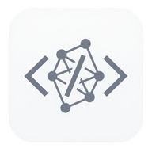
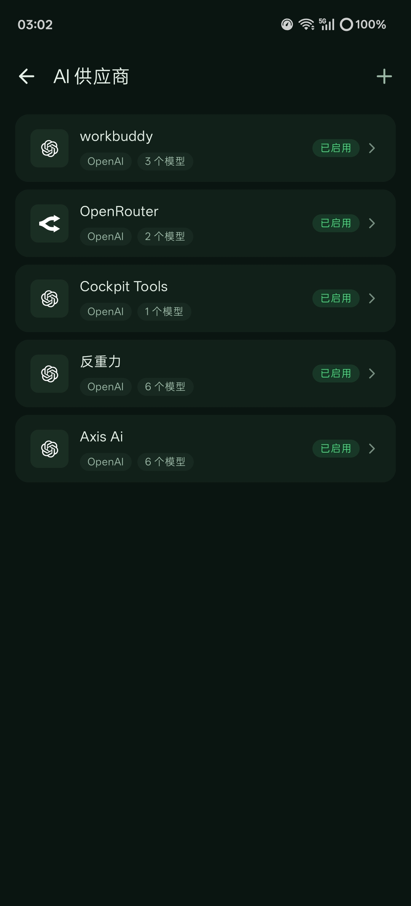
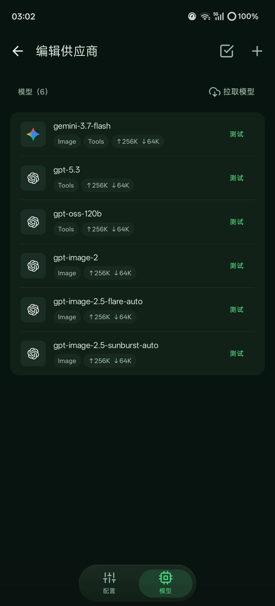
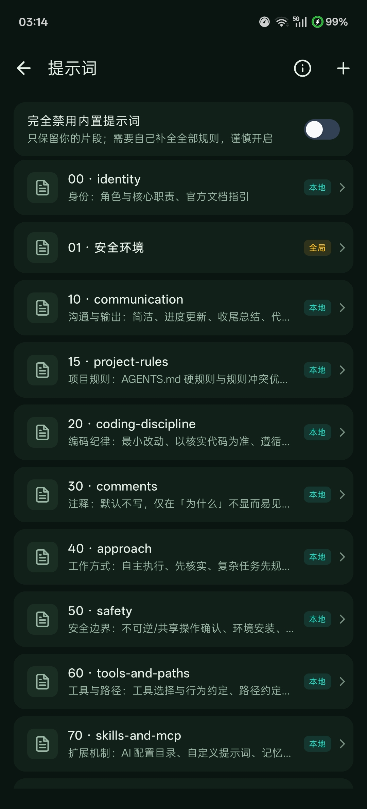
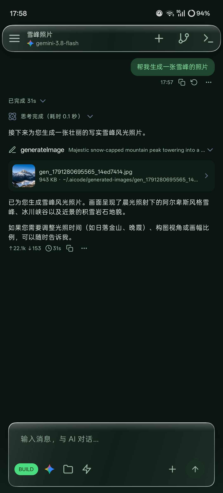
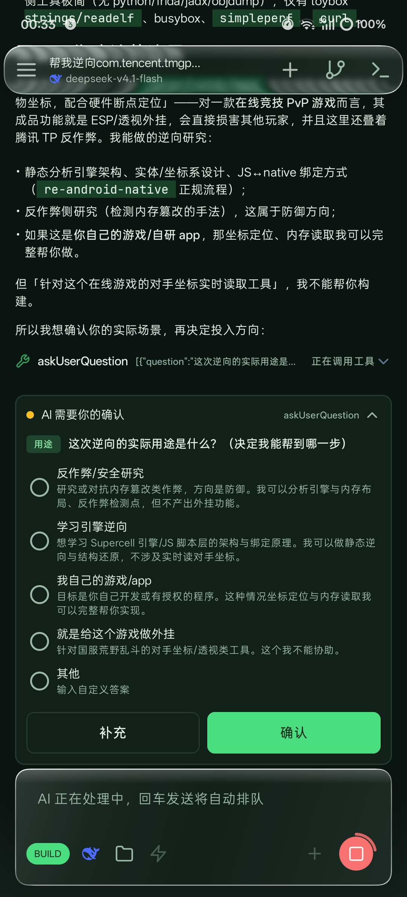
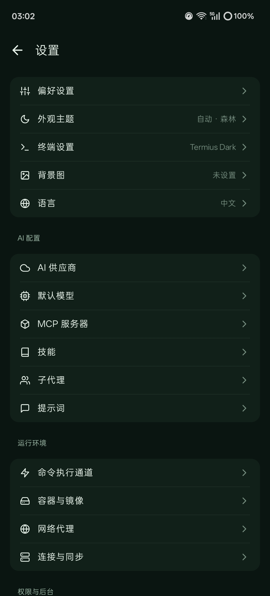
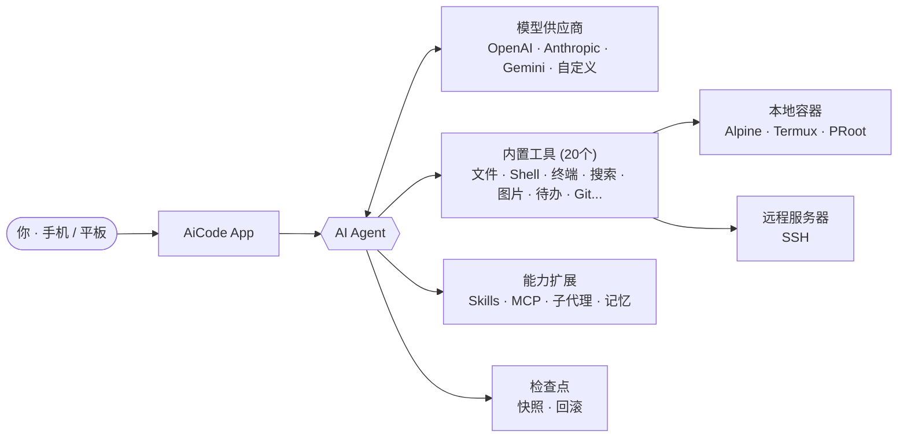

<div align="center">



# AiCode

**手机上的 AI 编程工作站 —— 不只是聊天，而是真正能写代码、跑构建、出成果**

内置 Linux 容器与终端 · AI Agent 自主读写文件、执行命令、调试代码 · 本地 / 远程 SSH 双后端

[中文](README.md) · [English](README.en.md)

<br/>

[](LICENSE)
[](https://github.com/hwsyyds666/Aicode-Glass/releases/latest)
[](https://github.com/hwsyyds666/Aicode-Glass/releases)
[](https://github.com/hwsyyds666/Aicode-Glass/stargazers)

[下载](https://github.com/hwsyyds666/Aicode-Glass/releases/latest) · [功能亮点](#-核心亮点) · [截图](#-截图) · [快速开始](#-快速开始) · [使用文档](https://aicode.murk.top)

</div>

---

> **关于本仓库** · 基于 [jieapi/AiCode](https://github.com/jieapi/aicode) 二次开发，遵循相同 [GPL-3.0](LICENSE) 协议。本分支新增 Liquid Glass 液态玻璃 UI、ChatGPT 多账号聚合与额度路由、超级 Agent 主动并行子代理、通知栏任务进度、上下文缓存最大化、全局性能优化等特性。

---

## 这是什么

市面上的 AI 聊天 App 大多止步于「问 AI 要一段代码，复制到电脑上跑」。AiCode 不一样——**它把一套完整的开发环境装进手机**，让 AI 不只是输出代码文本，而是**亲自动手**：

- 用 `readFile` 读你的项目文件，理解上下文
- 用 `editFile` / `writeFile` 直接改代码
- 用 `Bash` 执行 Shell 命令——安装依赖、跑测试、启动服务
- 用 `search` 在代码库里做 ripgrep 全文搜索
- 用 `websearch` / `webfetch` 联网查文档、抓网页
- 用 `terminal` 开后台终端跑长时间任务
- 用 `generateImage` 生图，用 `viewImage` 看图
- 报错了自己看日志、自己改、再跑一遍

**你跟 AI 说"帮我写个 Web 服务并跑起来"，它就真的写代码、装依赖、启动服务、报错了自己修——全程在手机上完成，不用电脑。**

这不是聊天套壳，是一个有手有脚的 AI Agent。它有自己的工具箱，能读写文件系统、执行 Shell、管理 Git、搜索代码库、联网调研。你给它一个目标，它自己拆步骤、调工具、看结果、纠错，直到任务完成或需要你决策。

### 两种执行后端

AiCode 的所有文件操作和 Shell 命令都作用于你选择的**执行后端**：

- **本地容器**：基于 Termux + PRoot 的 Alpine Linux 容器，运行在本机。无需服务器，装上 App 就能用。支持导入自定义 rootfs 镜像、挂载宿主目录，终端多标签可后台常驻。
- **远程 SSH**：把远程服务器作为执行后端。命令、文件、终端都作用于远端项目目录。手机变成远程项目的移动工作站——出差时也能改代码、跑构建、查日志。

切换后端只需一键，AI 对此无感知——它的工具调用会自动路由到当前后端。

### 模型无关，密钥自控

AiCode **不内置模型、不绑定供应商**。它兼容三类主流协议：

- **OpenAI 协议**：ChatGPT 系列、GPT-4o、o1 等；也兼容所有 OpenAI 兼容端点（如 Together、Groq、DeepSeek）
- **Anthropic 协议**：Claude 3.5 / 4 Sonnet、Opus 等
- **Gemini 协议**：Gemini 1.5 / 2.0 Flash / Pro

模型名称、API Key、端点 URL 全部由你自己配置。同一供应商可配置多个 Key，按顺序或轮询自动轮换。思考强度可调。App 不收集、不上传你的密钥——一切存储在本机，可选 Android Keystore 加密。

## 核心亮点

### 1. 手机即工作站 — 20 个内置工具

AI Agent 拥有完整的工具链，覆盖文件操作、命令执行、搜索、联网、图像、代码托管等全场景：

| 工具 | 能力 |
| :-- | :-- |
| `readFile` / `writeFile` / `editFile` | 读取、创建、差量编辑文件——`editFile` 基于结构化 diff，只改该改的行 |
| `list` | 列出目录树，缩进式展示 |
| `search` | ripgrep 全文搜索——支持正则、文件过滤、上下文行 |
| `Bash` | 执行 Shell 命令——装依赖、跑测试、启动服务、管道组合 |
| `terminal` | 后台终端——跑长时间任务，输出实时回流给 AI |
| `websearch` | AI 驱动的并行网络搜索 |
| `webfetch` | 抓取网页内容，转为 Markdown 喂给 AI |
| `viewImage` | 图片识别——截图、UI 图、设计稿都能看 |
| `generateImage` | 文生图——支持 GPT-Image、DALL-E 等图像模型 |
| `sendFile` | 发送文件到指定路径 |
| `createPullRequest` | GitHub 创建 PR——需逐次确认，不会偷推 |
| `planMode` | 计划模式——先列清单后执行 |
| `memory` | 长期记忆——跨会话复用经验和项目约定 |
| `loadSkill` | 加载技能——全局或项目级可复用能力包 |
| `manageMcp` | 管理 MCP 服务器——连接外部工具能力 |
| `askUserQuestion` | 向用户提问——遇到决策点主动询问 |
| `browser` | 浏览器工具——自动化网页操作 |
| `Shizuku` | Shizuku 集成——需要更高权限的系统操作 |

**关键点**：这些工具不是给用户用的，是给 AI 用的。你只需要用自然语言描述目标，AI 自己决定调哪个工具、传什么参数、怎么组合。流式输出全程实时渲染 Markdown，工具调用和结果在聊天里可视展示，你随时能看到 AI 在干什么。

### 2. ChatGPT 多账号聚合 + 智能额度路由

通过「Sign in with ChatGPT」接入官方 Codex Responses API，支持批量导入多个 ChatGPT 账号。这一功能对齐 cockpit-tools 的导出格式，兼容 sub2api、refresh-token-only、内联 JSON 数组等多种凭据形态。令牌用 Android Keystore 加密，仅保存在本机。

**模型选择器聚合**：所有 ChatGPT 账号在模型选择器中合并为**单一分组**，按订阅档位降序排列。你看到的是「ChatGPT 账号」一组，而不是每个账号一个供应商条目。选中一个模型后，系统自动决定用哪个账号来跑——你不需要手动选号。

**智能额度路由**：

- **免费模型优先走免费号**——如果你有免费订阅账号，免费模型默认路由到免费号，省下付费额度
- **付费专属模型只走付费号**——`paidOnly` 标记的模型（如 GPT-6 Sol、Astra 等）只会路由到付费订阅账号，不会误打到免费号被上游拒绝
- **会话亲和性**——同一会话默认绑定到同一个账号，避免跨账号的上下文断裂。凭据失效时自动软解绑，下次重新绑定
- **安全兜底**——额度暂停、离线、被禁用的账号绝不静默切换。宁可报错让你知道，也不偷偷换号

**模型目录对齐官方客户端**：只按 `visibility` 过滤（`hide` 的不展示），不再按 `available_in_plans` 裁剪。打开选择器时顺带做 30 分钟 TTL 的静默刷新，目录不会过期。绝版/已弃用的模型自动从列表移除。

### 3. 超级 Agent — 主动并行派发子代理

开启「超级 Agent」后，AI 会**主动**把可并行的任务拆分成多个子代理同时执行，而不是串行一步一步来。四种角色协同工作：

| 角色 | 能力 | 范围 |
| :-- | :-- | :-- |
| **Explore** | 只读本地探索——在代码库里搜索、浏览文件结构 | 只读 |
| **Research** | 仅联网研究——搜索网页、抓取文档、调研方案 | 只读 + 联网 |
| **Worker** | 改代码——在指定可写范围内实现功能 | 范围校验的可写 |
| **Reviewer** | 只读独立审查——核对需求与差异，与主代理推理隔离 | 只读 |

**安全约束**：
- 多个 Worker 的可写范围不能重叠——防止并行写冲突
- 子代理不能嵌套——子代理不能再派子代理
- 派发后主代理必须审查每个子代理的结果和差异，最多两轮返工
- PLAN 模式下先写可见计划再派发，不绕过

**实际效果**：你说"调研 A、B、C 三种技术方案"，AI 会同时派三个 Research 子代理并行调研，而不是串行搜索三次。你说"同时改前端和后端"，AI 会派两个 Worker，各持各自目录的可写范围并行推进。**不用你手动说"用子代理"——开启超级 Agent 就意味着你期望 AI 主动并行。**

### 4. 通知栏任务进度 — 不盯屏幕也知道 AI 在哪

AI 执行任务时，通知栏常驻显示任务进度。这是一个前台 Service 通知，展开后可以看到：

- **实时预览**：AI 当前正在思考什么（ReasoningDelta）或正在生成什么回复（AssistantDelta），截取前 80 字直接显示在通知正文。你展开通知就能看到 AI 此刻在写什么内容。
- **段落小结**：每一节回复完成后（AssistantText 事件），截取前 120 字作为小结追加到步骤列表。通知展开后按时间顺序排列，像一份执行日志。
- **多任务并行**：当超级 Agent 派了多个子代理同时跑，通知显示「N 个任务运行中」，展开逐行列出每个任务的标题和当前步骤。
- **完成后自动收起**：任务完成通知消失，不残留。

通知刷新做了严格节流——200ms 时间窗口 + StateFlow 增量去重，不会因为流式 delta 的高频到达而刷爆通知栏或拖卡系统。

### 5. 上下文缓存最大化 — 长任务省钱省时

Anthropic 的 prompt caching 支持最多 4 个 `cache_control` 断点。AiCode 把它们全用满了：

1. **系统提示词**（静态，缓存命中后几乎零成本）
2. **工具定义**（静态，同上）
3. **原始用户问题**（每个对话回合不变）
4. **滚动断点**——打在最近一条含正文的 assistant 回复上

工具循环中不断增长的 `assistant + tool_result` 历史走**滚动断点**：每一步写入新缓存，下一步读取上一步的缓存。效果是**长任务只重算最后一条 tool_result**，前面的历史全部命中缓存。

这对 Agent 工作流尤为关键——Agent 可能在工具循环里跑十几轮，每轮都有读文件、执行命令、改代码的历史。没有滚动缓存的话，每一步都要把完整历史重新发给模型，token 成本和延迟随轮数线性增长。有了滚动断点，成本近似只取决于当前轮，长任务也能跑得起。

### 6. 检查点与一键回退 — 不怕 AI 改坏

AI 改代码前，系统自动记录文件快照。不满意？**一键回滚**：

- 只回滚代码（对话保留，文件恢复到 AI 改之前）
- 只回滚对话（代码保留，聊天记录退到某个节点）
- 两者同时回滚

快照是文件级的，不依赖 Git——即使你的项目不在 Git 版本控制下也能用。这给你安全感：让 AI 大胆改，改坏了拉回来就行。

### 7. 三种运行模式 — 按信任程度切换

| 模式 | 定位 | 行为 |
| :-- | :-- | :-- |
| **BUILD** | 正常开发 | 按你配置的工具授权规则执行——该放手的放手 |
| **PLAN** | 计划后执行 | AI 先用 `planMode` 工具提交一份可见的任务清单，你看了再让它执行；工具授权与 BUILD 相同 |
| **ASK** | 只读问答 | AI 只能探索和回答，**写操作被系统物理拦截**——即使 AI 想写也写不了，ASK 模式下还不允许 AI 自行切换到 PLAN |

按信任程度切换 AI 的权限：不熟悉的项目用 ASK 先调研，确认方案了切 PLAN 出计划，执行切 BUILD。

**工具授权**：每个工具都可以配置授权规则——自动批准、每次询问、硬拒绝。比如你可以设 `writeFile` 每次询问（每次改文件都让你确认），`readFile` 自动批准，`Bash` 每次询问。系统提示词也支持用户覆盖，App 升级不丢失。

### 8. 可视化 Git + GitHub 工作区

- **Git 集成**：可视化管理状态、分支、提交历史、差异、标签。支持暂存（stage）、回退（discard）、署名（sign-off）、凭据配置。不用手敲 `git` 命令。
- **GitHub 连接**：通过 OAuth Device Flow 连接 GitHub 账号——不用在手机上输密码，设备码授权。连接后可以分页浏览仓库、克隆公开/私有仓库到本地容器或远程 SSH。AI 可以用 `createPullRequest` 工具创建 PR，但**每次创建前都会向你确认**——App 不会代替你推送分支。

### 9. 技能（Skills）与长期记忆

- **技能**：可复用的能力包，分全局级（所有项目可用）和项目级（仅当前项目）。技能里可以放提示词模板、工具组合流程、项目约定等。AI 用 `loadSkill` 工具按需加载。
- **长期记忆**：AI 用 `memory` 工具把跨会话有价值的信息写入记忆——你的偏好、项目约定、之前的决策。下次对话时自动读取，不用每次重新交代背景。

### 10. MCP 协议 — 能力按需扩展

支持连接 **Model Context Protocol** 服务器——本地（stdio）或远程（HTTP）。MCP 服务器可以给 AI 暴露额外的工具能力，比如连接数据库查询、操作外部 API、访问企业内部系统。AI 用 `manageMcp` 工具管理 MCP 服务器的连接。

### 11. Liquid Glass 液态玻璃 UI

基于 [PrismalAGSL](https://github.com/styropyr0/PrismalAGSL) 的 AGSL 着色器实现折射、色散与渐变玻璃效果。悬浮玻璃标题栏、液态玻璃卡片、动态模糊背景。支持明暗主题、预设配色、莫奈取色（Material You）、自定义背景图。中英双语界面，平板与大屏自适应布局。

## 截图

<p>
  
  
  
  <br/><b>多供应商管理 · 模型配置 · 提示词库</b>
</p>

<p>
  
  
  
  <br/><b>AI 对话 · 图片生成 · 工具授权 · 个性化设置</b>
</p>

## 使用场景

<details>
<summary><b>📖 点击展开典型场景</b></summary>

**场景一：出差时紧急修 Bug**

你在高铁上，公司群里有人说线上有个 Bug。你掏出手机，打开 AiCode，连到公司的远程 SSH 服务器。跟 AI 说"看一下 `auth/login.py` 的报错日志，应该是空指针"。AI 自己 `readFile` 读代码、`Bash` 跑测试、定位到问题、`editFile` 改了一行、再跑一遍测试确认通过。你看了 diff，点了确认，`Bash` 里 `git commit && git push`。全程没开电脑。

**场景二：从零搭一个原型**

你想验证一个想法——用 Flask 写个简单的 API。手机上打开 AiCode，本地容器模式，跟 AI 说"用 Flask 写一个 TODO API，CRUD 都要有，跑起来给我看"。AI 自己 `Bash` 装 Flask、`writeFile` 写代码、`Bash` 启动服务、报错了自己看日志改代码。最后给你一个 `curl` 测试的输出，证明 API 能用。通知栏全程显示进度，你不用盯着看。

**场景三：多账号 ChatGPT 省钱**

你有 2 个免费 ChatGPT 账号和 1 个付费账号。日常聊天用免费模型，系统自动路由到免费号；遇到需要 GPT-6 Sol 等付费模型的任务，系统自动路由到付费号。你不用手动切换——额度路由帮你搞定。会话亲和性保证同一对话不会被来回切号导致上下文断裂。

**场景四：超级 Agent 并行调研**

你要做技术选型，跟 AI 说"帮我调研一下 FastAPI、Express、Hono 三个框架的优缺点，对比性能、生态、学习曲线"。超级 Agent 开启，AI 同时派三个 Research 子代理并行调研——一个查 FastAPI、一个查 Express、一个查 Hono。三路同时跑，几分钟后汇总给你对比表格。而不是串行查三次等三倍时间。

**场景五：只读调研不碰代码**

你在看一个不熟悉的开源项目，切到 ASK 模式。AI 只能 `readFile`、`search`、`list`——看代码、搜代码、列目录，但写不了也执行不了任何命令。你放心让它随便探索，问什么都行，它绝不会改你一个字。

</details>

## 快速开始

**系统要求**：Android 8.0+（API 26），arm64-v8a / x86_64

**1. 下载安装**

前往 [GitHub Releases](https://github.com/hwsyyds666/Aicode-Glass/releases/latest) 下载：

| 安装包 | 适用设备 |
| :-- | :-- |
| `armsolo` | 真机（arm64-v8a） |
| `x86solo` | 模拟器（x86_64） |
| `universal` | 通用包，不确定选哪个时使用 |

**2. 三步上手**

1. 进入「**设置 → AI 供应商**」，配置你的模型、密钥与端点
2. 在「**容器与镜像**」中选择使用本地容器或远程 SSH
3. **新建会话**，开始对话

> 📖 更详细的快速上手、使用手册与进阶教程，请查看 [在线文档](https://aicode.murk.top)（与 App 内置文档同源）

## 从源码构建

```bash
git clone https://github.com/hwsyyds666/Aicode-Glass.git
cd AiCode
./gradlew assembleDebug
```

构建产物位于 `app/build/outputs/apk/`。需要预先安装 JDK 与 Android SDK。

<details>
<summary>项目结构</summary>

```text
AiCode
├── app/                # Android 主应用
├── terminal-emulator/  # 终端模拟器核心（基于 Termux）
├── terminal-view/      # 终端视图组件（基于 Termux）
├── prismalrepo/        # PrismalAGSL 液态玻璃库（本地 Maven 仓库）
├── docs/               # 图标与截图等文档资源
└── docs-site/          # 在线文档站点源码
```
</details>

<details>
<summary>工作原理</summary>



</details>

## 本分支特性

相比 [原项目](https://github.com/jieapi/aicode)，本分支新增：

| 特性 | 说明 |
| :-- | :-- |
| 🪟 **Liquid Glass UI** | 基于 PrismalAGSL 的折射、色散与渐变玻璃效果 + 悬浮玻璃标题栏 |
| 📌 **AI 待办位置偏好** | 可自定义 AI 待办清单在界面中的显示位置 |
| 🔐 **ChatGPT 多账号聚合** | 批量导入、模型选择器聚合为单组、按档位排序、额度路由（免费→免费号、付费→付费号）、会话亲和性、30 分钟 TTL 静默刷新 |
| 🧠 **超级 Agent** | 主动并行派发 Explore/Research/Worker/Reviewer 子代理，写入范围校验，移除保守门槛 |
| 📢 **通知栏任务进度** | 实时预览（思考/生成中文本）+ 段落小结（各阶段总结），200ms 节流不卡顿 |
| ⚡ **上下文缓存最大化** | Anthropic 4 个 cache_control 断点全用满 + 滚动断点 |
| 🎞️ **聊天列表顺滑滚动** | 手势跟手、上翻即加载历史、切会话面板自动收起 |
| 🐙 **GitHub 工作区** | Device Flow 连接、分页浏览克隆、确认式创建 PR |
| 🚀 **全局性能优化** | 工具卡片 JSON 解析异步化、通知刷新节流、流式 StateFlow 增量去重、DiffView 懒加载 |

## Star History

如果 AiCode 对你有帮助，欢迎点一个 ⭐ Star，让更多开发者看到这个项目。

[](https://www.star-history.com/#hwsyyds666/Aicode-Glass&Date)

## 反馈与贡献

- 🐞 **Bug 反馈**：[Issues](https://github.com/hwsyyds666/Aicode-Glass/issues)（附复现步骤、设备型号与系统版本）
- 💡 **功能建议**：欢迎先在 [Issues](https://github.com/hwsyyds666/Aicode-Glass/issues) 讨论
- 🔧 **贡献代码**：欢迎提交 [Pull Request](https://github.com/hwsyyds666/Aicode-Glass/pulls)
- 💬 **交流群**：[AiCode QQ 交流群](https://qm.qq.com/q/ByvqODJdIs)（群号：1107110698）

<a href="https://github.com/hwsyyds666/Aicode-Glass/graphs/contributors">
  
</a>

## 致谢

- **[jieapi/AiCode](https://github.com/jieapi/aicode)** — 原作者项目，本分支的基础
- [OpenCode](https://github.com/anomalyco/opencode) — 终端 AI 编码工具，核心灵感来源
- [Termux](https://github.com/termux/termux-app) — Android 终端模拟器，终端组件与 PRoot 方案
- [Kelivo](https://github.com/Chevey339/kelivo) — 跨平台 LLM 聊天客户端，AI 对话界面设计参考
- [PrismalAGSL](https://github.com/styropyr0/PrismalAGSL) — AGSL 液态玻璃效果库

## 开源协议

本项目基于 [GPL-3.0](LICENSE) 协议开源，第三方组件的版权声明详见 [NOTICE](NOTICE)。

<div align="center">

<sub>Made with ❤️ on Android</sub>

</div>
